# 115 kWp Commercial Rooftop Solar PV: BOM, Procurement and Cost Control in Excel, SQL and Power BI

Live on portfolio: **[usamajaved.ie](https://usamajaved.ie/roles/planning)**

Bill of materials, string voltage verification, procurement lead-time tracking and cost control for a **115 kWp commercial rooftop PV system** in Islamabad (**198 Jinko 580 W modules** in 11 strings of 18 on a **Huawei SUN2000-100KTL-M2** inverter). This is a sample project: module and inverter data come from the manufacturers' datasheets, and the PKR rates are indicative.

---

## 1. Advanced Excel Workbook (`excel/115-kWp-commercial-rooftop-excel-demo.xlsx`)

Checks the string design against the inverter's voltage limit, prices the 19-line bill of materials, sets an order-by date for each item from the date it is needed on site, and tracks budget against committed and forecast cost.

- **String cold-voltage check**: 18 modules per string reach **1,012 V** on a -5 C morning, inside the inverter's **1,100 V** limit.
- **Cost position**: Budget **PKR 7,106,670** against a committed cost of **PKR 6,430,580** and a forecast of **PKR 7,144,010** (**PKR 37,340 over budget**).
- **Procurement tracking**: 7 items need action (including the inverter ordered 4 working days after its order-by date).
- **Excel features used**: Excel Tables, `XLOOKUP`, `SUMIFS`, `COUNTIF`, nested `IF`, `WORKDAY.INTL`, conditional formatting and a PivotTable with a supplier slicer.

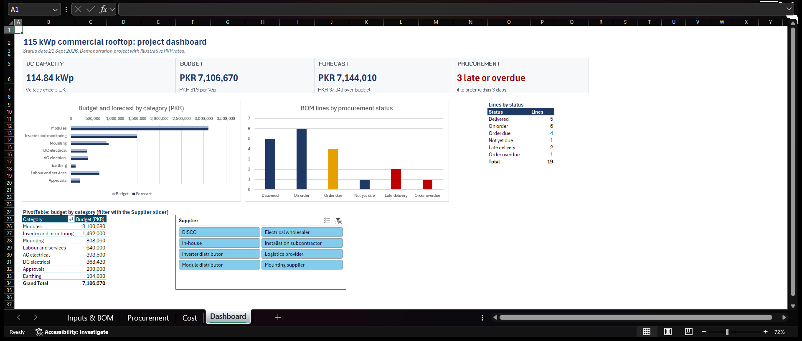
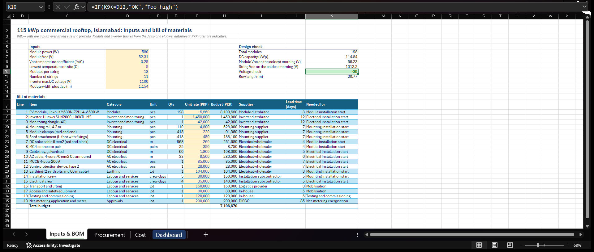
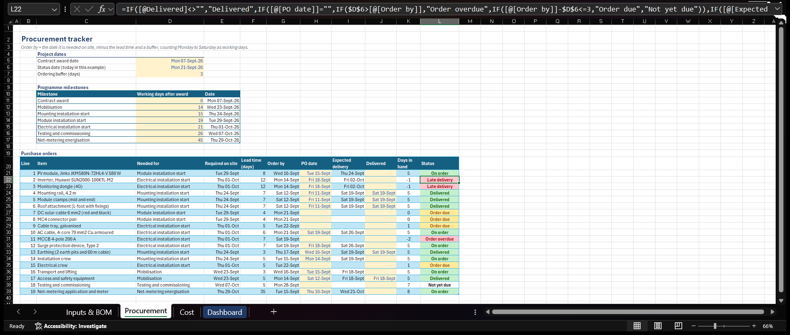
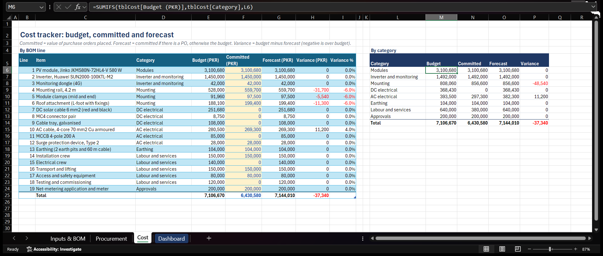

---

## 2. Power BI Report (`power-bi/`)

A one-page report for the same 115 kWp rooftop, fed from the Excel tracker. It shows budget, forecast and variance at a glance, compares budget and forecast for each cost category, counts BOM lines by procurement status, and lists the items that need action, most urgent first.

- **Power Query**: imports and cleans the cost and procurement tables, filters out Excel's total row (`Line <> null`), and sets data types across all 19 BOM lines.
- **DAX measures**: `Budget`, `Forecast`, `Variance` (`[Budget] - [Forecast]`) and `Lines`.

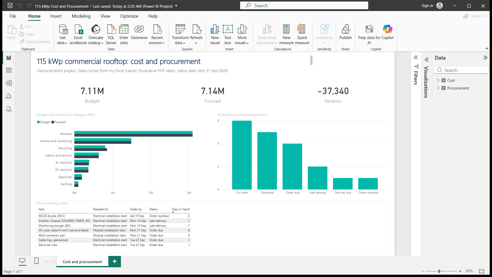
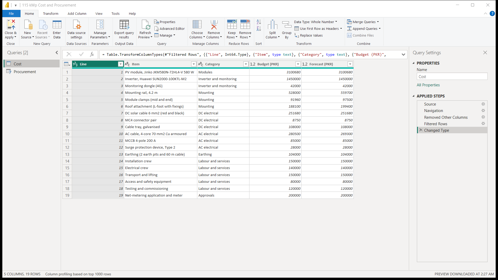
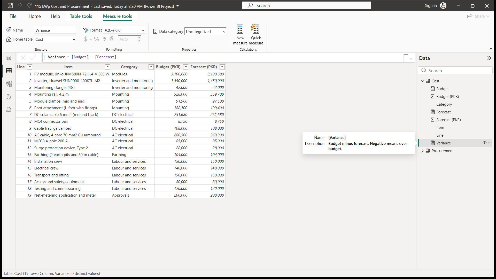

---

## 3. SQLite Database and Queries (`sql/`)

An SQLite database (`sql/solar_project.db` and `sql/115-kWp-commercial-rooftop-sql-demo.sql`) built from the Excel tracker with two linked tables:
- `bom`: quantity, unit rate, budget and forecast for each of the 19 lines (`line` primary key).
- `procurement`: order-by date, delivery date and status for each line, linked to `bom` on `line`.

Seven queries in `sql/2 - queries.sql` pull out the most expensive items, the budget by category (`GROUP BY`), the procurement status counts, a `JOIN` between the two tables for the 7 items that need ordering or chasing (most urgent first), and the over-budget lines.

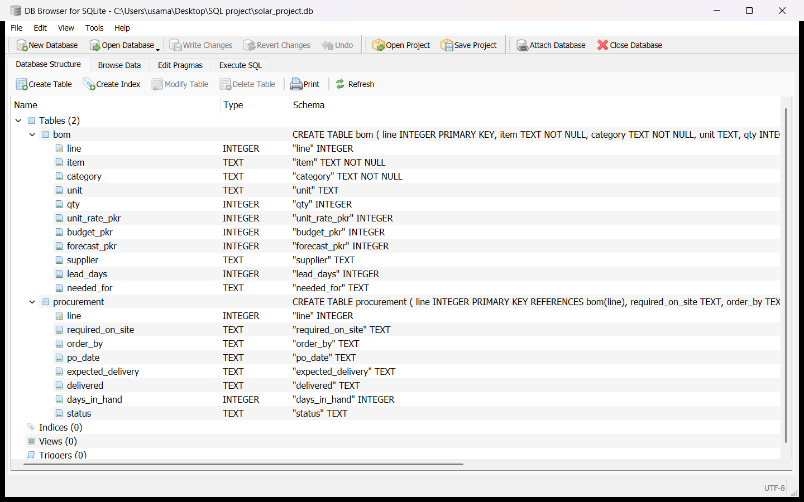
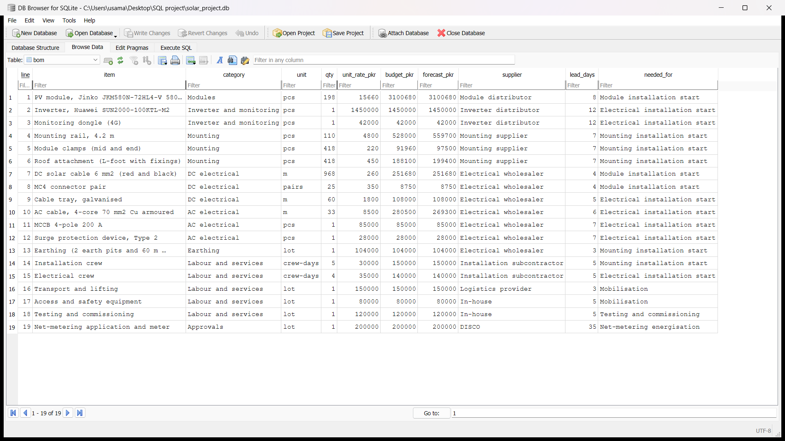
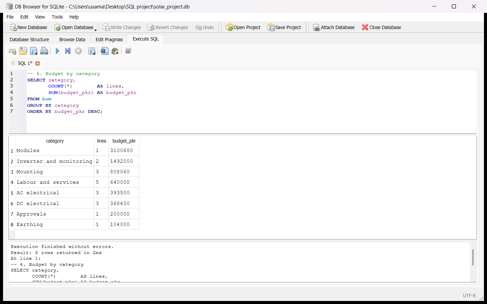
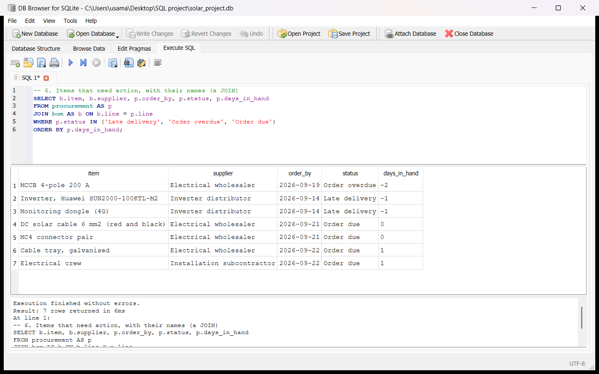

---

## Related Solar PV Engineering, Planning and Analytics Projects by Usama Javed

- **Portfolio Website**: [usamajaved.ie](https://usamajaved.ie) ([Project Planner / Scheduler](https://usamajaved.ie/roles/planning) · [Solar Project / Technical Engineer](https://usamajaved.ie/roles/project-engineering) · [Site Supervisor / Field Delivery](https://usamajaved.ie/roles/site-delivery) · [Energy / Reporting Analyst](https://usamajaved.ie/roles/energy-analytics))
- **[80kw-pv-bess-autocad-dispatch](https://github.com/usamajaved1305/80kw-pv-bess-autocad-dispatch)**: 80 kW commercial rooftop PV and 63 kWh FoxESS battery storage in AutoCAD 2027 (A1 sheets PV-01, PV-03, PV-04) and 8,760-hour Python dispatch simulation
- **[115kwp-solar-energy-yield-python](https://github.com/usamajaved1305/115kwp-solar-energy-yield-python)**: 115 kWp commercial rooftop PV energy yield model in Python (Jupyter, pandas, matplotlib, PVGIS ERA5) and HelioScope simulation
- **[115kwp-solar-bom-cost-procurement](https://github.com/usamajaved1305/115kwp-solar-bom-cost-procurement)**: 115 kWp commercial rooftop PV BOM, string voltage verification, procurement tracker and cost control in Excel, SQLite and Power BI
- **[20kw-rooftop-pv-schedule-and-shading](https://github.com/usamajaved1305/20kw-rooftop-pv-schedule-and-shading)**: 20 kW residential rooftop PV installation programme (Primavera P6 and MS Project), OpenSolar proposal and SketchUp 3D ray-traced shading check
- **GitHub Profile**: [github.com/usamajaved1305](https://github.com/usamajaved1305) · **LinkedIn**: [linkedin.com/in/usama-javed-553b8624b](https://www.linkedin.com/in/usama-javed-553b8624b)
